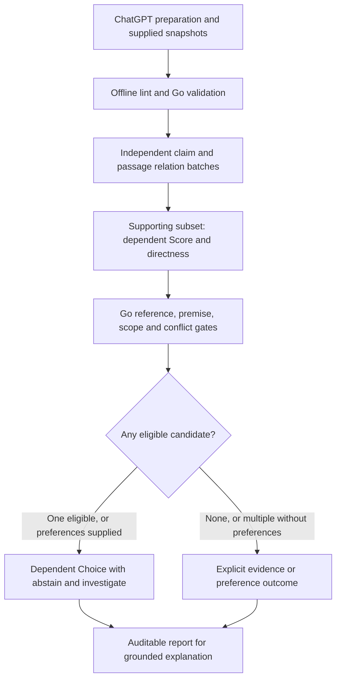

# Maintain the evidence pipeline

Use `cmd/jev-evidence` for the evidence workflow. ChatGPT prepares explicit options, requirements, claims, premises and supplied passages, then explains the report. Go validates the contract and applies eligibility policy. TypeSafe/Jev answers narrow evidence questions. Source retrieval and generative preparation stay outside the server.

## Follow the phase dependencies

Relation results establish the supporting subset before sufficiency runs. Counterevidence remains separate. Only candidates passing mandatory requirements reach Choice; preferences cannot compensate for a failed requirement. Applicable ambiguous relations leave the claim unresolved. An additional insufficient-information passage does not erase otherwise complete support.

Native Score remains a probability-weighted value. The adapter validates its legend and preserves raw values, distributions and actual confidence; a unique modal anchor supplies an advisory semantic level. Ties remain unresolved. Go independently rejects proposed Complete judgments with missing references, unsupported indispensable premises or relevant counterevidence. Documentary support does not establish empirical truth or source reliability.

## Keep module responsibilities narrow

| Location | Responsibility |
| --- | --- |
| `internal/evidence/types.go` | Versioned plans, profiles, claims, requirements, judgments and reports. |
| `internal/evidence/validate.go` and validation helpers | Bounded offline validation, exact excerpts, linkage, supported versions, dates, digests and heuristic warnings. |
| `internal/evidence/normalize.go` and `provenance.go` | Computed source hashes, original input hash, cited snapshot locations, provenance and observed model identities. |
| `internal/evidence/evaluate.go`, `execute.go`, `policy.go` | Phase ordering, one deadline, bounded batches/concurrency/retries, coverage and deterministic eligibility. |
| `internal/evidence/calibration.go` | Offline held-out metrics, evidence-group checks and diagnostic threshold sweeps. |
| `internal/typesafe` | Direct bearer-authenticated TypeSafe contract, typed primitive validation and secret-safe errors; no retries or fallback hidden from the core. |
| `internal/mcpserver` | Shared SDK tools, stdio and stateless loopback Streamable HTTP, authentication, Host/Origin protections and queued cancellation. |
| `cmd/jev-evidence` | Local serving, status, explicit plan linting and authenticated model discovery. |
| `cmd/jev-calibrate` | Developer-only analysis of recorded original fixtures; no provider calls. |
| `testdata/evidence` | Original preparation, expected-report and labeled calibration fixtures. |

The preserved upstream `cmd/jev-mcp` serves primitive questions and retains its original provider/fallback behavior. Those settings do not alter the evidence entry point.

## Preserve the evidence contract

A plan uses stable IDs and explicit candidate-to-requirement-to-claim links. Claims name indispensable premises and assumptions. Sources contain supplied snapshots, known dates, origin/dependency metadata and typed scope. Exact excerpts use half-open UTF-8 byte ranges. Omitted source hashes are computed; incorrect supplied hashes are rejected. Unknown provenance or independence remains unknown.

Source URLs and paths are metadata and are never fetched or opened. The CLI may read an explicitly selected plan file. Source instructions remain untrusted evidence throughout. Structural checks and bounded heuristics cannot prove semantic completeness, atomization, entailment, independence or real-world correctness.

Keep execution validity separate from evidence judgments. Valid level-0/1 classifications are successful execution. Cancellation, exhausted budgets and skipped phases are incomplete work; malformed provider output and operational provider failures have separate outcomes. A server or tunnel outage may prevent any report and must not become a zero-support judgment.

## Reproduce the implementation sequence

The local implementation followed these completed steps; retain their acceptance criteria when extending it:

1. **Adapt the existing checkout and verify sources.** Preserve upstream licensing, attribution and the primitive entry point. Acceptance: the chosen upstream revision and research/API/license decisions are recorded in [source review](source-review.md).
2. **Define typed contracts and offline linting.** Acceptance: unsupported versions, bounds, invalid IDs/linkage, cycles, bad hashes and incorrect excerpt locations are rejected without retrieval or provider calls.
3. **Implement the direct provider adapter.** Acceptance: local HTTP contract tests validate batching, authentication, model discovery, Score legends, uncertainty, malformed/partial output, redirects and secret-safe failures. No provider/model fallback is permitted.
4. **Implement dependent evaluation and Go gates.** Acceptance: tests preserve mixed evidence, copied origins, scope/date mismatches, unsupported premises, checkable derivations and ambiguous relations; Choice cannot restore an ineligible candidate. Retries count against the same call/input/deadline limits.
5. **Expose the shared MCP tools through both transports.** Acceptance: SDK clients exercise preparation fixtures through the real TypeSafe adapter against a local HTTP mock, Go policy and auditable reports over stdio and HTTP. Security and queued-cancellation checks retain local boundaries and audit records.
6. **Add original calibration fixtures and CLI.** Acceptance: held-out results exclude training cases, reject stale recorded versions, separate documentary mistakes from policy acceptance, and check complete alternative evidence groups. Sweeps never select a production cutoff.
7. **Verify and document local delivery.** Acceptance: the exact checks and observed results appear in [verification](verification.md); [operations](operations.md) covers configuration, outages, shutdown, approved tunnel setup and the optional public OAuth/TLS path. Live provider, authenticated ChatGPT and iOS proof remain separate opt-in work.

## Preserve upstream attribution

This checkout derives from [tphakala/jev-mcp at f51a9267f74a641f44f90fa5e1a8d3125edc9a35](https://github.com/tphakala/jev-mcp/tree/f51a9267f74a641f44f90fa5e1a8d3125edc9a35). The Apache-2.0 license and upstream notices remain. Original fixtures avoid restricted research datasets; [source review](source-review.md) records the license distinctions.
